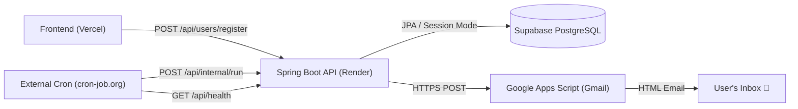

# 🎂 Never-Forget — Automated Birthday Wishes Engine

An autonomous, full-stack birthday scheduler and delivery platform built with **Java & Spring Boot 3**, backed by **Supabase PostgreSQL**, containerized with **Docker on Render**, and integrated with **Google Apps Script** for personalized email dispatching.


---

## ⚡ Quick Architecture Overview



- **Frontend**: Vanilla HTML5, CSS3, JavaScript.  
- **Backend**: Java 17, Spring Boot 4.1.3, Spring Data JPA, Hibernate, Docker.
- **Database**: PostgreSQL hosted on Supabase (using Session Mode pooler).
- **Email Engine**: Google Apps Script Web App wrapper around Gmail `MailApp.sendEmail()`.
- **Hosting & Infrastructure**: Render (Docker Web Service) + cron-job.org (wake-up & automation trigger).

---

## 🛠️ Backend Details..


### 1. Database Schema & Entities

The database consists of only two focused tables in Supabase:

#### `users` Table
Stores registered friends and community members.
- `id` (BIGSERIAL, Primary Key)
- `username` (VARCHAR, Not Null)
- `email` (VARCHAR, Unique, Not Null) 
- `country` (VARCHAR, Not Null)
- `date_of_birth` (DATE, Not Null)
- `created_at` (TIMESTAMP, Auto-populated on `@PrePersist`)

#### `email_logs` Table
Tracks every single delivery attempt to prevent duplicate annual sends and handle retries.
- `id` (BIGSERIAL, Primary Key)
- `user_id` (BIGINT, Not Null)
- `email_type` (VARCHAR) — e.g. `"BIRTHDAY"` or `"WELCOME"`
- `birthday_year` (INTEGER) — e.g. `2026`
- `status` (VARCHAR) — `"SENT"`, `"FAILED"`
- `retry_count` (INTEGER, Default 0)
- `sent_at` (TIMESTAMP)

---

### 2. Core Backend Capabilities & Endpoints

| Method | Endpoint | Description | Security / Details |
| :--- | :--- | :--- | :--- |
| **`GET`** | `/api/health` | Service health check, ping telemetry, user count & daily quote. | Public, CORS enabled |
| **`GET`** | `/api/users/count` | Returns total registered count. | Public |
| **`POST`** | `/api/users/register` | Validates input, saves user, and dispatches instant welcome email. | Validated with `@Valid` |
| **`POST`** | `/api/internal/run` | Triggers daily IST birthday evaluation and retries failed attempts. | Protected by `X-Cron-Secret` header |


#### D. Google Apps Script Dispatcher via Java 11 `HttpClient`
Java's built-in `HttpClient` sends JSON payloads directly to Google Apps Script's Web App endpoint:
- Configured with `.followRedirects(HttpClient.Redirect.ALWAYS)` to seamlessly follow Google's `302 Found` redirects.
- Injects dynamic variables (like `{{username}}`) into standalone HTML email templates.

---

## 🚀 Environment Variables & Configuration

The application uses zero hardcoded credentials. All secrets are passed securely via environment variables:

| Environment Variable | Description | Example / Format |
| :--- | :--- | :--- |
| `SPRING_DATASOURCE_URL` | Supabase Session Pooler JDBC URL | `jdbc:postgresql://aws-1-[region].pooler.supabase.com:5432/postgres?sslmode=require` |
| `SPRING_DATASOURCE_USERNAME` | Supabase Database Username | `postgres.[project-ref]` |
| `SPRING_DATASOURCE_PASSWORD` | Supabase Database Password | `your-db-password` |
| `APP_EMAIL_SCRIPT_URL` | Deployed Google Apps Script Web App URL | `https://script.google.com/macros/s/AKfycb.../exec` |
| `APP_CRON_SECRET` | Secret key protecting `/api/internal/run` | `your-secret-cron-token` |
| `APP_CORS_ALLOWED_ORIGINS` | Permitted frontend origins | `https://your-frontend.vercel.app` (or `*`) |
| `PORT` | Dynamically injected container port on Render | `10000` (defaults to `8080` locally) |

---

## 🐳 Docker & Production Deployment

### Dockerfile (Multi-stage Build)
```dockerfile
# Run locally with Docker
docker build -t birthday-app .
docker run -p 8080:8080 --env-file .env birthday-app
```

---


## 🎨 Note on the Frontend

The frontend interface was built entirely using AI prompts and design systems. I wanted keeping all my core manual coding effort focused on the backend Java & database architecture.

---

## 👨‍💻 Author & Acknowledgements

- **Developer**: Bhaskar Ojha
- **Special Thanks**: **Tushit Tiwari** for assisting with integration testing, email delivery verification, and backend reliability checks.
